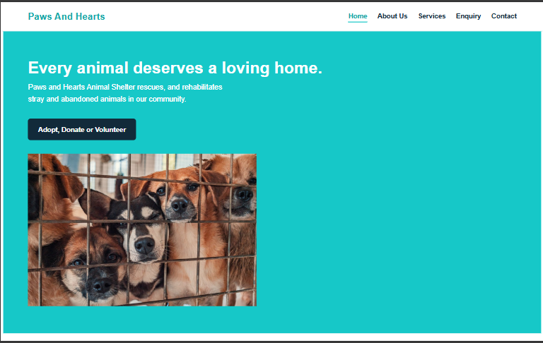
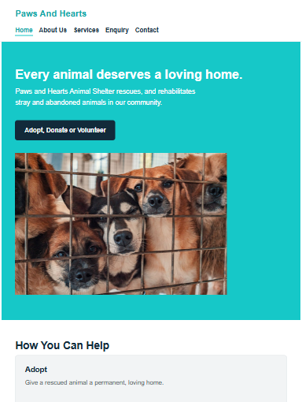
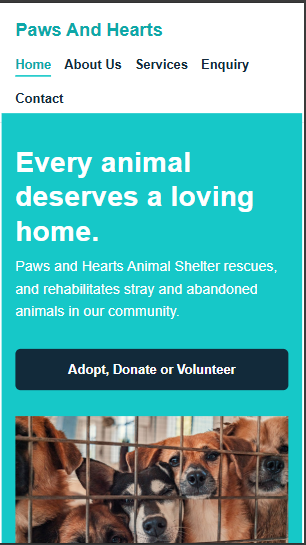

# Paws & Hearts Animal Shelter Website

## Student Information
- **Full Name:** Tiisetso Chipa
- **Student Number:** st10524693
- **Module:** Web Development [INSERT MODULE CODE]
- **Group:** Group 3

## Project Overview
Paws & Hearts Animal Shelter is a hypothetical non-profit organisation that rescues,
rehabilitates and rehomes stray and abandoned animals in the local community. This
repository contains the source code for its website, built as part of the Web
Development Portfolio of Evidence (PoE).

## Website Goals and Objectives
- Increase local adoption enquiries.
- Grow the volunteer base.
- Raise awareness and donations to fund the shelter's day-to-day running costs.
- KPIs: number of adoption enquiry submissions, volunteer sign-ups, and clicks on
  the donate call-to-action.

## Key Features and Functionality
- Responsive 5-page website (Home, About Us, Services, Enquiry, Contact).
- Consistent navigation across all pages.
- Enquiry form covering adoption, volunteering, and sponsorship (client-side
  validation to be added in Part 3).
- Two locations listed on the Contact page (main shelter and satellite clinic).

## Timeline and Milestones

| Part 1 | Planning, research, HTML structure | Weeks 1-4 |
| Part 2 | CSS styling and responsive design | Weeks 5-8 |
| Part 3 | JavaScript functionality, SEO, forms | Weeks 9-12 |

## Part 1 Details
- Website Project Proposal completed and approved for Paws & Hearts Animal Shelter.
- Sitemap created (see below).
- File and folder structure established.
- HTML structure created for all 5 pages.

## Part 2 Details

### Colour Palette and Design Choices
The palette uses a warm, friendly teal as the brand colour (hero sections and animal
cards), a dark navy for headings, a light grey for backgrounds and
panels, and white for content areas. 

### Typography
The site uses the **Nunito** font (a rounded, friendly sans-serif). Heading sizes
are set on a simple scale (`h1` 2.4rem, `h2` 1.7rem, `h3` 1.2rem) and body text is
1rem, so the hierarchy is clear and consistent on every page.

### Layout Structure
- The header uses **Flexbox** (`display: flex` with `justify-content: space-between`)
  to place the logo on the left and the navigation on the right.
- Card groups (How You Can Help, animal cards, services, history/mission columns)
  use flex rows with `flex-wrap`, so they sit side by side on desktop.
- The Enquiry and Contact pages use a two-column flex layout: intro content on the
  left, form panel on the right.

### Visual Styles
- Interactive states are styled with pseudo-classes: `a:hover` underlines links and
  turns the logo teal, `nav a:hover` adds a teal bottom border, and `a:focus` shows a
  visible teal outline for keyboard users
- Cards use `border-radius` and a light border for a soft, friendly look.
- All five pages share one consistent stylesheet (`css/style.css`) 

### Responsive Design
- **Breakpoints:** two media queries `max-width: 48rem` (768px, tablet) and
  `max-width: 30rem` (480px, mobile). Breakpoints are written in `rem` so they also
  respond to the user's base font-size settings.
- **Layout changes:** card grids switch from multi-column to a single column on
  smaller screens; the header stacks vertically; the hero text and button go
  full-width.
- **Relative units:** font sizes and spacing use `rem`, and layout widths use `%`
  and `flex`, so elements scale smoothly instead of breaking at fixed pixel sizes. (Elemuwa, F)
- **Responsive images:** every `img` has `max-width: 100%; height: auto;` so images
  never overflow their containers, and animal card images use `object-fit: cover`.

### Screenshot Evidence (Home page)

**Desktop (1366px):**


**Tablet (768px):**


**Mobile (390px):**


## Sitemap
The diagram below shows the website's structure: Home sits at the top level, with
four pages branching directly off it.


```
Home (index.html)
 About Us (about.html)
 Services (services.html)
 Enquiry (enquiry.html)
 Contact (contact.html)

## File and Folder Structure

paws-and-hearts/               (root folder)
index.html                  Homepage
about.html                  About Us page
services.html                Services / adoptable animals page
enquiry.html                 Enquiry form page
contact.html                  Contact page

## References
## Part 1
- Mark, W., 2026. *Nonprofit organizations: How they work and what they do*.
  [blog] Available at: <https://www.boardeffect.com/blog/governs-nonprofit-organizations/>
  [Accessed 4 August 2026].
- Shelter Animals Count, 2026. *Understanding Animal Welfare Organizations: Types
  of Shelters, Rescues, and Services*. [blog] Available at:
  <https://www.shelteranimalscount.org/understanding-animal-welfare-organizations>
  [Accessed 4 August 2026].
- Google Fonts, 2026. *Nunito*. [online] Available at:
  <https://fonts.google.com/specimen/Nunito> [Accessed 4 August 2026].

##Part 2
- Elemuwa, F, 2026. *rem vs em - Everything you need to know*.
  [blog] Available at: <https://refine.dev/blog/rem-vs-em/>
  [Accessed 6 October 2026]
- MDN Web Docs, 2026. *Targeting media types*. [online] Available at:
  <https://developer.mozilla.org/en-US/docs/Web/CSS/Guides/Media_queries/Using#targeting_media_types>
  [Accessed 6 October 2026].
- MDN Web Docs, 2026. *Responsive images*. [online] Available at:
  <https://developer.mozilla.org/en-US/docs/Learn/HTML/Multimedia_and_embedding/Responsive_images>
  [Accessed 6 October 2026].
