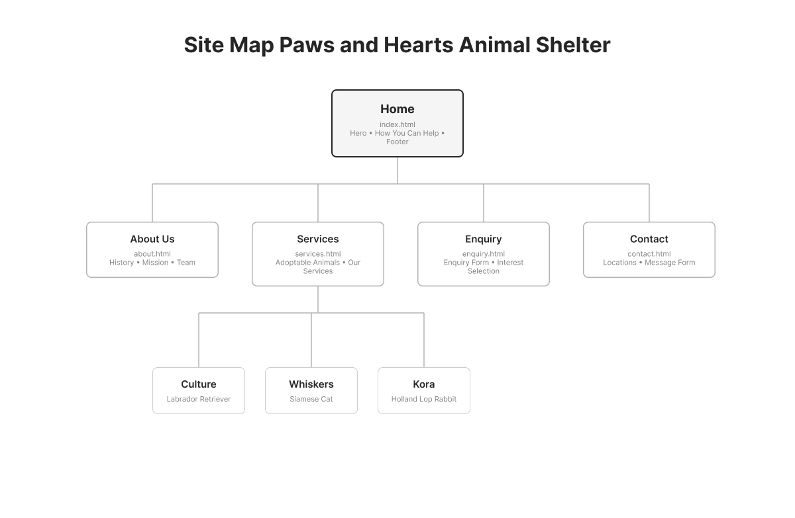

# Paws & Hearts Animal Shelter Website

## Student information
- Full name: Tiisetso Chipa
- Student number: st10524693
- Module: Web Development
- Group: Group 3

## Project milestone summary
| Part 1 | Planning and website structure | Completed |
| Part 2 | Styling and responsive design | Completed |
| Part 3 | Functional improvements, JavaScript, and SEO | Completed |

## Project overview
Paws & Hearts is a fictional animal shelter website created to help animals in need find safe homes. The site promotes adoption, donations, volunteering, and pet welfare awareness. Part 3 focuses on improving the website by fixing earlier issues, adding JavaScript functionality, and improving search engine visibility.

## Part 1
### Website structure and planning
- Created the initial website structure for the animal shelter brand.
- Designed the main pages for home, about, services, enquiry, and contact.
- Planned the navigation flow and basic content layout.
- Set up the website with clear page hierarchy and basic content sections.

## Part 2
## Part 2 Details

### Colour Palette and Design Choices
The palette uses a warm, friendly teal as the brand colour (hero sections and animal
cards), a dark navy for headings, a light grey for backgrounds and
panels, and white for content areas. 

### Typography
The site uses the **Nunito** font (a rounded, friendly sans-serif). Heading sizes
are set on a simple scale (`h1` 2.4rem, `h2` 1.7rem, `h3` 1.2rem) and body text is
1rem, so the hierarchy is clear and consistent on every page.

### Layout Structure
- The header uses **Flexbox** (`display: flex` with `justify-content: space-between`)
  to place the logo on the left and the navigation on the right.
- Card groups (How You Can Help, animal cards, services, history/mission columns)
  use flex rows with `flex-wrap`, so they sit side by side on desktop.
- The Enquiry and Contact pages use a two-column flex layout: intro content on the
  left, form panel on the right.

### Visual Styles
- Interactive states are styled with pseudo-classes: `a:hover` underlines links and
  turns the logo teal, `nav a:hover` adds a teal bottom border, and `a:focus` shows a
  visible teal outline for keyboard users
- Cards use `border-radius` and a light border for a soft, friendly look.
- All five pages share one consistent stylesheet (`css/style.css`) 

### Responsive Design
- **Breakpoints:** two media queries `max-width: 48rem` (768px, tablet) and
  `max-width: 30rem` (480px, mobile). Breakpoints are written in `rem` so they also
  respond to the user's base font-size settings.
- **Layout changes:** card grids switch from multi-column to a single column on
  smaller screens; the header stacks vertically; the hero text and button go
  full-width.
- **Relative units:** font sizes and spacing use `rem`, and layout widths use `%`
  and `flex`, so elements scale smoothly instead of breaking at fixed pixel sizes. (Elemuwa, F)
- **Responsive images:** every `img` has `max-width: 100%; height: auto;` so images
  never overflow their containers, and animal card images use `object-fit: cover`.

### Styling and responsive design
- Added the visual design and layout styling for the site.
- Improved the page structure with responsive sections and content cards.
- Updated the forms, buttons, and pages to look more professional.
- Corrected navigation and page consistency across the website.
- Improved accessibility by using clear headings, spacing, and descriptive alt text.
- Reworked the form layout to be clearer and easier to use on mobile devices.
- Fixed layout issues so cards, buttons, and form content look cleaner and more consistent.
- Added a responsive mobile menu for smaller screens.

## Part 3
### 1. Problems fixed from earlier work Part 2
- Fixed broken or inconsistent page links across the website.
- Corrected file naming and navigation issues so the pages open correctly.
- Improved content hierarchy and readability with better headings and spacing.
- Updated form layout and accessibility to make the site clearer and more user-friendly.
- Added working JavaScript functionality
- Improved overall layout consistency and responsiveness.
- Added SEO metadata.

### 2. Functionality improvements
- Added a working mobile navigation menu.
- Added hover and animation effects to buttons, cards, and navigation links.
- Added a search box to help users find animals by name or category.
- Added category and price filters to refine the pet listings.
- Loaded the pet data using JavaScript.
- Added a lightbox so users can click animal images to view them larger.
- Improved the enquiries and contact form layout for a more professional look.
- Added working form validation with error messages and confirmation messages.

### 3. SEO improvements
- Added unique page titles to every page.
- Added meta descriptions to each page.
- Added semantic headings and cleaner content hierarchy.
- Added descriptive alt text to images.
- Added viewport metadata for mobile devices.
- Created a robots.txt file to guide search engine crawlers.
- Created a sitemap.xml file for indexing.
- Added the sitemap reference image in images/SiteMap.png.
- Added social sharing for better preview cards on social media.
- Improved page clarity and loading structure to support faster rendering.

### 4. Security and performance updates
- Avoided unnecessary external dependencies that may make the site slow or inconsistent.
- Kept scripts lightweight and focused on required functionality.
- Added browser-side validation to support form accuracy.
- Protected important user-facing forms with clear validation checks.
- Ensured the website structure remains clean, and responsive

### 5. Additional requests 
- Robots.txt: Created to instruct search engine crawlers on which pages to index.
- Sitemap.xml: Created to help search engines understand the website structure.
- Sitemap image: Stored at images/SiteMap.png.
- Page speed: Improved by keeping the project lightweight and efficient.
- Security: Added sensible validation and kept the site free from risky external dependencies.

## Files added or updated for Part 3
- css/style.css - updated styles for responsiveness, animation, buttons, filters, lightbox, and mobile layout
- js/main.js - JavaScript for search, filter, loading data, lightbox, and responsive menu
- js/main.test.js - basic validation tests for product search and filter functions
- robots.txt - search engine crawling instructions
- sitemap.xml - site index file
- README.md - updated project documentation

## Website pages
- Home: HTML folder/Index.html
- About Us: HTML folder/about.html
- Services: HTML folder/services.html
- Enquiry: HTML folder/enquiry.html
- Contact: HTML folder/contact.html

## Sitemap
The diagram below shows the website's structure: Home sits at the top level, with
four pages branching directly off it.



```
Home (index.html)
 About Us (about.html)
 Services (services.html)
 Enquiry (enquiry.html)
 Contact (contact.html)

## File and Folder Structure

paws-and-hearts/               (root folder)
index.html                  Homepage
about.html                  About Us page
services.html                Services / adoptable animals page
enquiry.html                 Enquiry form page
contact.html                  Contact page

## References
## Part 1
- Mark, W., 2026. *Nonprofit organizations: How they work and what they do*.
  [blog] Available at: <https://www.boardeffect.com/blog/governs-nonprofit-organizations/>
  [Accessed 4 August 2026].
- Shelter Animals Count, 2026. *Understanding Animal Welfare Organizations: Types
  of Shelters, Rescues, and Services*. [blog] Available at:
  <https://www.shelteranimalscount.org/understanding-animal-welfare-organizations>
  [Accessed 4 August 2026].
- Google Fonts, 2026. *Nunito*. [online] Available at:
  <https://fonts.google.com/specimen/Nunito> [Accessed 4 August 2026].

##Part 2
- Elemuwa, F, 2026. *rem vs em - Everything you need to know*.
  [blog] Available at: <https://refine.dev/blog/rem-vs-em/>
  [Accessed 6 October 2026]
- MDN Web Docs, 2026. *Targeting media types*. [online] Available at:
  <https://developer.mozilla.org/en-US/docs/Web/CSS/Guides/Media_queries/Using#targeting_media_types>
  [Accessed 6 October 2026].
- MDN Web Docs, 2026. *Responsive images*. [online] Available at:
  <https://developer.mozilla.org/en-US/docs/Learn/HTML/Multimedia_and_embedding/Responsive_images>
  [Accessed 6 October 2026].

##Part 3
- MDN Web Docs. 2026. *Using media queries*. [Online] Available at: https://developer.mozilla.org/en-US/docs/Web/CSS/Guides/Media_queries/Using#targeting_media_types
